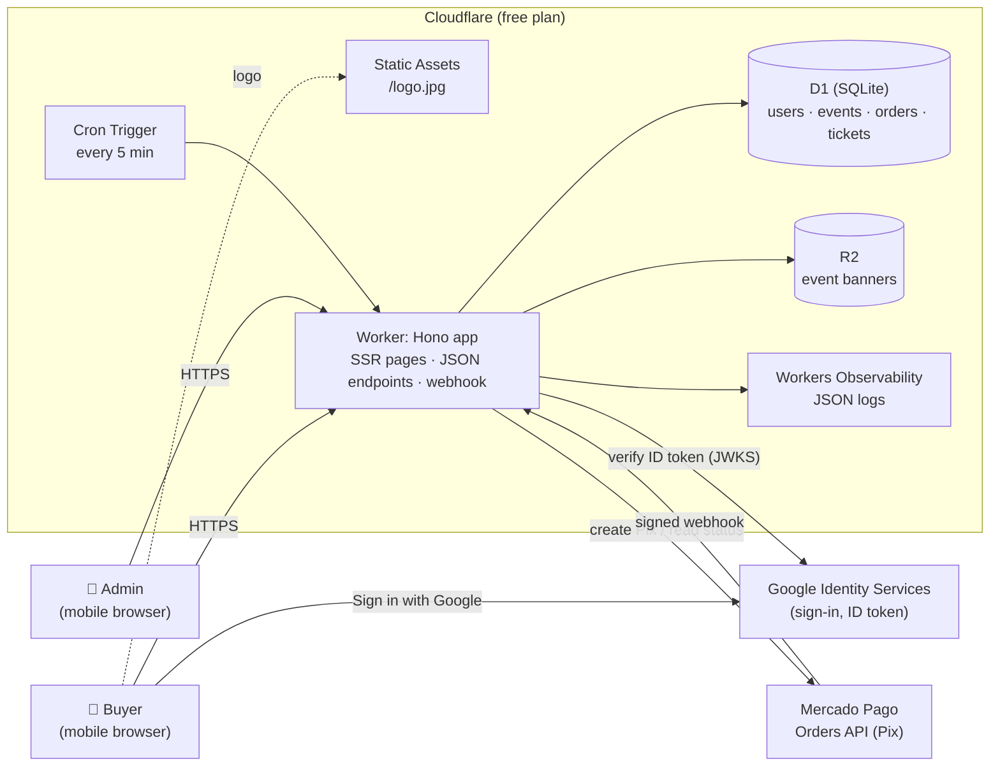
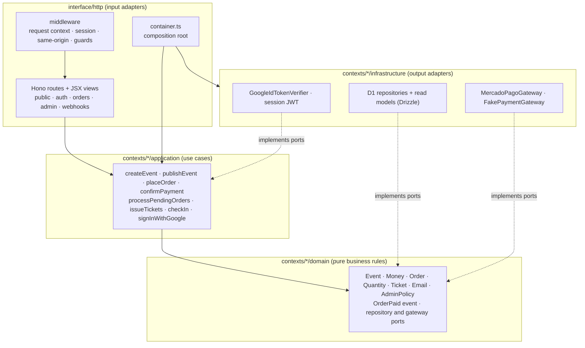
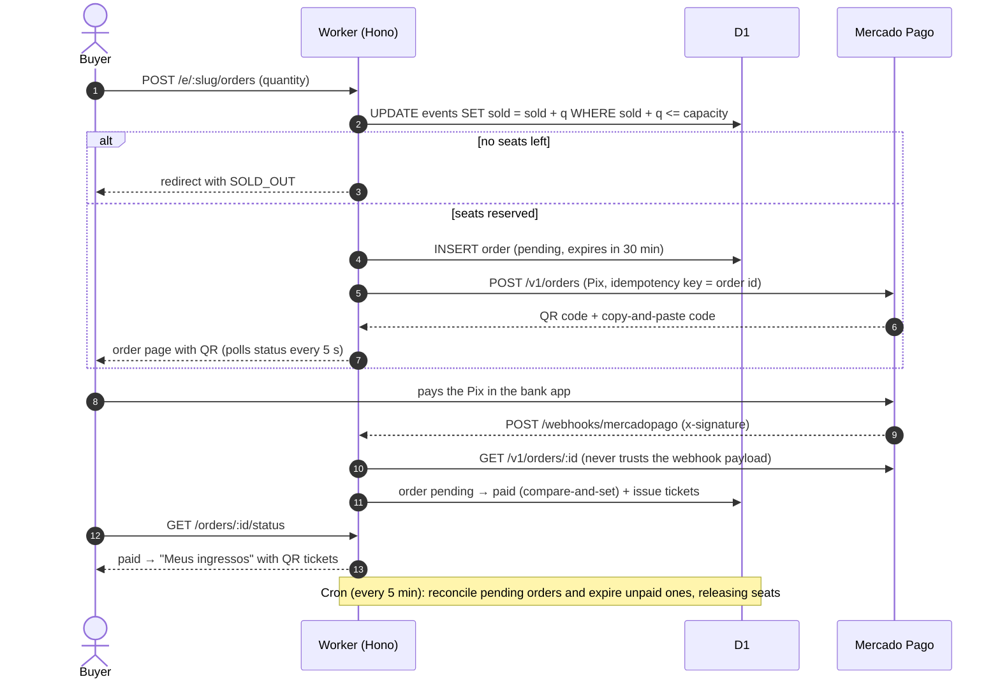

# Arena CB Tickets

A mobile-first event ticketing system with **Pix** payments for Arena CB (Capão Bonito/SP). It replaces the manual Instagram + Excel + Pix-receipt workflow and costs ~92% less than Sympla's fee (see [docs/costs.md](docs/costs.md)).

- **Admin** (Google accounts listed in `ADMIN_EMAILS`): creates/publishes events, shares the link, sees the paid list, exports CSV, checks tickets in with the phone camera.
- **Buyer** (any Google account): opens the link, signs in with Google, pays with Pix, receives QR-code tickets.

Stack: Node.js 26 LTS (tooling) · TypeScript · Hono (SSR JSX) · Cloudflare Workers + D1 + R2 · Drizzle · Mercado Pago Orders API · Vitest · Biome. Architecture: DDD + Clean Architecture ([CLAUDE.md](CLAUDE.md), [ADR 0001](docs/adr/0001-stack.md)).

## Architecture

### Runtime (single production environment)



### Code layers (DDD + Clean Architecture)

Dependencies point inward: `domain` imports nothing from the outer layers, and the wiring happens only in the composition root (`src/interface/http/container.ts`).



Bounded contexts: `identity` · `events` · `sales` · `payments` · `ticketing`.

### Pix purchase flow



## Local development

Requires **Node.js 26 LTS** (pinned in `.nvmrc`; CI reads the same file).

```bash
nvm use                                 # or install Node 26 LTS another way
npm ci
cp .dev.vars.example .dev.vars          # fake gateway + test mode by default
npm run db:migrate:local
npx wrangler d1 execute DB --local --file scripts/seed-local.sql   # optional demo event
npm run dev                             # http://localhost:8787
npm test                                # unit + integration (D1 in miniflare)
```

Google sign-in locally requires a real OAuth Client ID with `http://localhost:8787` as an authorized JavaScript origin.

## First deploy (PoC on `*.workers.dev`)

1. **Cloudflare:** `npx wrangler login`, then:
   ```bash
   npx wrangler d1 create arena-cb-tickets      # copy database_id into wrangler.jsonc
   npx wrangler r2 bucket create arena-cb-tickets-banners
   npx wrangler deploy                           # prints https://arena-cb-tickets.<account>.workers.dev
   ```
2. **Google OAuth:** in Google Cloud Console → Credentials, create an *OAuth client ID (Web)* and add the workers.dev URL to *Authorized JavaScript origins*. Put the client id in `GOOGLE_CLIENT_ID` and the URL in `APP_URL` (`wrangler.jsonc` vars).
3. **Mercado Pago (test):** in *Suas integrações*, create an application and test accounts (seller + buyer). Use the **test seller's** access token, then configure the webhook URL `https://<app>/webhooks/mercadopago` (topic *Order*) and copy the secret.
4. **Secrets:**
   ```bash
   openssl rand -hex 32 | npx wrangler secret put SESSION_SECRET
   npx wrangler secret put ADMIN_EMAILS        # e.g. dono@gmail.com
   npx wrangler secret put MP_ACCESS_TOKEN
   npx wrangler secret put MP_WEBHOOK_SECRET
   ```
5. `npm run db:migrate:remote && npm run deploy`.
6. Optional CI/CD: add `CLOUDFLARE_API_TOKEN` and `CLOUDFLARE_ACCOUNT_ID` as GitHub secrets; every push to `main` runs dependency audit → lint → typecheck → tests → migrations → deploy.

Validate the Mercado Pago sandbox behaviour with `scripts/mp-sandbox-spike.ts` ([ADR 0002](docs/adr/0002-mercadopago-pix-testing.md)), then follow the [PoC script](docs/poc-script.md).

## Security scanning

- **SAST:** [CodeQL](.github/workflows/codeql.yml) (`security-extended` queries for JavaScript/TypeScript) runs on every push to any branch, on every pull request and weekly. Findings show up in **Security → Code scanning** and as a check on pull requests.
- **SCA:** `npm audit --omit=dev --audit-level=high` runs in [CI](.github/workflows/ci.yml) and fails the build on high/critical vulnerabilities in runtime dependencies.

## Operations (12-factor)

- Config only through env vars/secrets, validated on boot (`src/config.ts`). An invalid config fails fast with every issue listed.
- Structured JSON logs (`requestId`, `orderId`, `eventId`) in Workers Observability: `npx wrangler tail` streams them live.
- `GET /health` for uptime checks. Roll back with `npx wrangler rollback`.
- A cron runs every 5 minutes to reconcile pending Pix orders with Mercado Pago and release expired reservations.
